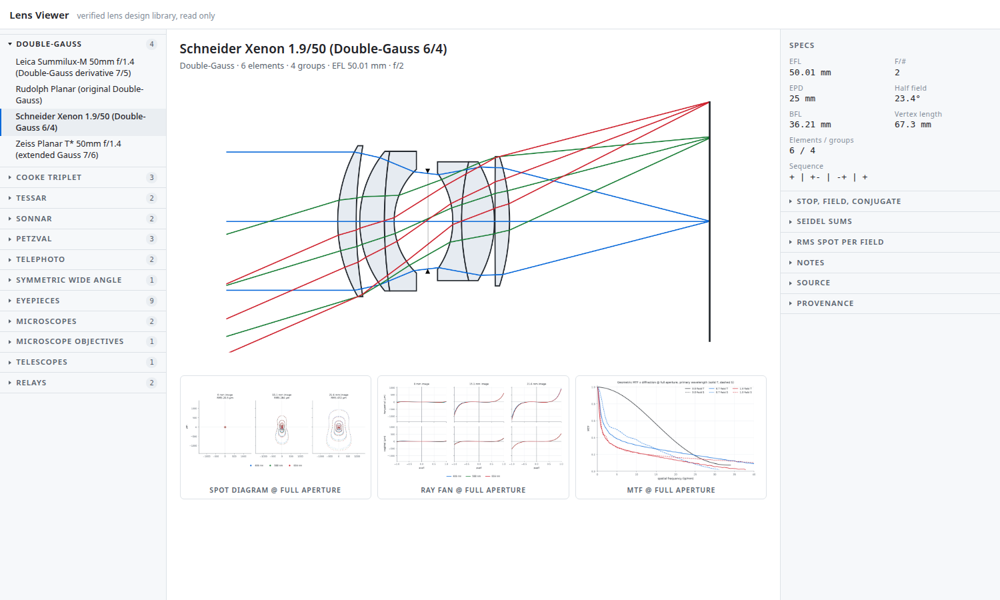

# Basic Optical Design Library

A browser/viewer for basic optical designs. This is a lens reference, not a designer: nothing here is edited or recomputed in the browser.

## What you see




For each design: a cross-section of the lens, a spot diagram, a ray fan, and an MTF plot, plus the specs, and Seidel sums.

The library is a set of classic forms:

- Singlets (biconvex, plano-convex, meniscus)
- Achromat and apochromat doublets
- Cooke triplet, Tessar, Double-Gauss, Sonnar, Petzval
- Retro-focus / wide-angle, telephoto
- Telescope objectives
- Eyepieces
- Microscope objectives

Designs whose data is public are shown. A few forms are noted as future expansion rather than listed empty.

## The plots

MTF, spot, and ray fan come from [optiland](https://github.com/optiland/optiland), an open-source ray-tracing and optimization library. The cross-sections are drawn from each design's prescription, with each element sized to its clear aperture and the beams narrowed by the aperture each field angle actually sees.

Two things worth knowing when reading a plot:

- MTF, spot, and ray fan are traced at full aperture. The cross-section shows the apertures reducing with field angle; the plots do not. So on a fast lens, off-axis the plots include light the drawing shows vignetted.
- MTF is plotted to 40 line pairs per millimeter, and stops at its first null.

## The data

Every design is an [optiland](https://github.com/optiland/optiland) prescription plus a card that records where it came from: source, locator, license, and any reference values it carries. Verification states what was checked against the source and what was not.

This repository builds a static read-only page from that library. The library itself is a separate private repository; only public designs appear here.


## Run it locally

```bash
cd site
python3 -m http.server 8000
# open http://localhost:8000
```

## Roadmap

Next planned additions: reflecting telescope forms, more objective families, zip-and-download prescriptions, and a 3D view. 